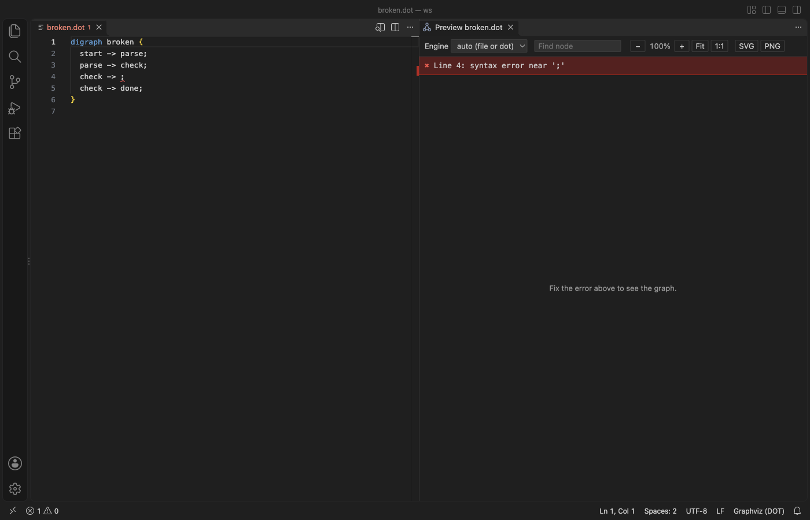
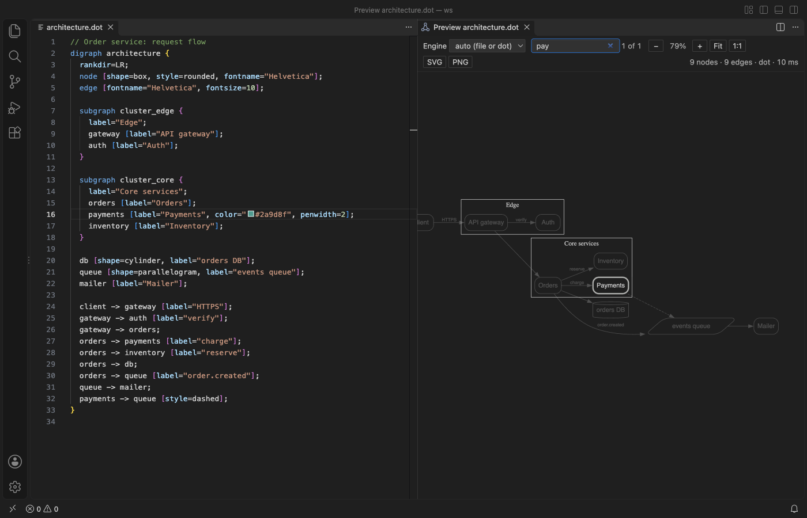
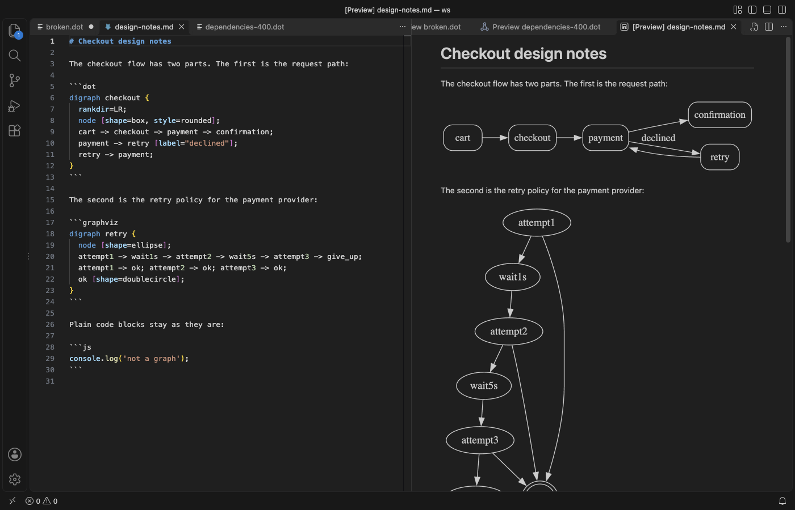
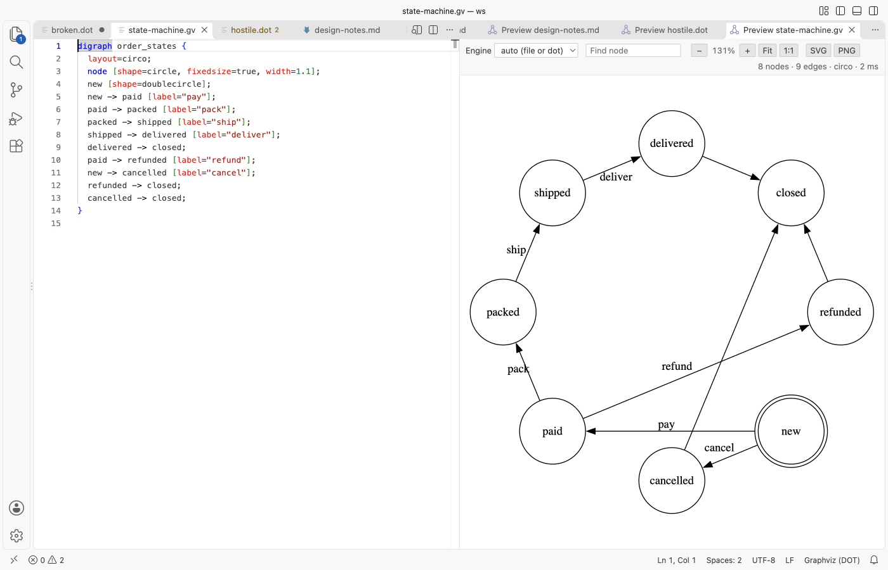

# Graphviz Preview & DOT Viewer

-informational)

See your Graphviz graph beside the `.dot` file as you type, click a node to jump to its line, and export it to SVG or PNG, with no Graphviz install.

*Real output from VS Code 1.142 on macOS. The file is `architecture.dot` from `scripts/make-samples.js`, opened from the installed .vsix and captured through the debug port.*

- Nothing to install. Graphviz 16.1 ships inside the extension as WebAssembly, so it works on a locked-down laptop, in a container and on a plane. Layouts run in a separate thread with a time limit, so a huge graph can't freeze VS Code.
- Errors land on the right line. A syntax error is underlined in the editor and listed in Problems, and the preview keeps the last good drawing while you fix it.
- It reads like part of VS Code. Default black lines and text take your theme's colors in dark mode, and colors you set in the graph stay as they are.

## Quick start

1. Install Graphviz Preview & DOT Viewer.
2. Open a `.dot` or `.gv` file and click the preview icon in the editor title, or press Cmd+K V (Ctrl+K V on Windows and Linux).

"Graphviz: Get Started" in the Command Palette opens a short tour.

## What it does

The preview redraws 300 ms after you stop typing. You don't need to save. The status line shows the node and edge count, the engine and the layout time.

Click the banner line to put the cursor on the error. Warnings, such as an unknown shape, show in the same banner in yellow and in Problems.

### Pan, zoom, find and jump

Drag to pan. The mouse wheel and trackpad also pan, and Cmd or Ctrl plus the wheel zooms at the pointer. Fit and 1:1 reset the view, and the keys `+`, `-`, `0` and `1` do the same when the graph has focus.

Type in Find node to light up every node whose name or label matches. The rest fade out. Enter moves to the next match and centers it, and Shift+Enter goes back. Click any node, edge or cluster to put the cursor where it's written in the source. For a node that is the line where it's declared with attributes, or else its first edge.

### Layout engines

Pick dot, neato, fdp, sfdp, circo or twopi from the toolbar. "auto" uses the `layout=` attribute of the graph, or dot when there is none. A `layout=` in the file wins over the picker, and the status line says so. Set the default for new previews with `graphvizPreview.defaultEngine`.

### Dot blocks in Markdown

Fenced blocks with the language `dot`, `graphviz` or `gv` are drawn in VS Code's own Markdown preview. Run "Graphviz: Open Preview to the Side" in a Markdown file to get the full preview for one block. It follows the block under your cursor, and a picker lists them all.

### Export

SVG saves the Graphviz output. PNG saves it at 2x on a white background. Both use the original Graphviz colors, not the dark-theme colors, so the file looks right in a document or a wiki. The save dialog starts next to the source file.

## Settings

| Setting | Default | What it does |
|---|---|---|
| `graphvizPreview.defaultEngine` | `auto` | Engine for new previews |
| `graphvizPreview.updateDelayMs` | `300` | Wait after typing before redrawing |
| `graphvizPreview.renderTimeoutSeconds` | `15` | A longer layout is stopped and the preview says so |
| `graphvizPreview.maxSourceKB` | `4096` | Bigger graphs are not laid out |
| `graphvizPreview.theme` | `auto` | `auto`, `light`, `dark` or `original` colors |
| `graphvizPreview.markdownPreview` | `true` | Draw dot blocks in the Markdown preview |
| `graphvizPreview.markdownMaxBlockKB` | `256` | Bigger blocks are not drawn in the Markdown preview |
| `graphvizPreview.askForRating` | `true` | Ask one time for a Marketplace rating after a few days of use |
| `graphvizPreview.showSupportLinks` | `true` | Show the small Sponsor and More free viewers links under the graph |

## Privacy and safety

The extension makes no network calls and has no telemetry. The preview runs under a strict Content Security Policy with no remote sources. Graphviz output is cleaned before it's shown, which removes scripts, external links (`URL` and `href` attributes) and images. Label text is always shown as text. Graphviz runs on a virtual file system inside WebAssembly, so an `image=` attribute can't read files from your disk.

## Limits

- One preview per file. Previews are not restored after a restart.
- Diagnostics come from the open preview. Close it and the problems for that file go away.
- `image=` attributes and HTML labels with `` draw no picture, by design.
- Very large or dense graphs can take a while with dot. sfdp is usually much faster for thousands of nodes.

## Support

Zovo extensions have no ads and no tracking, and sponsors pay for the time that goes into fixes and new viewers. You can sponsor the work on [GitHub Sponsors](https://github.com/sponsors/theluckystrike).

## More viewers by Zovo

- [Large JSON Viewer & JSON Tree](https://marketplace.visualstudio.com/items?itemName=zovo.zovo-json-tree-viewer) shows large JSON files as a searchable tree, copies JSONPath and turns arrays of objects into a table.
- [PDF Viewer & PDF Reader with Dark Mode](https://marketplace.visualstudio.com/items?itemName=zovo.pdf-viewer-dark) reads PDFs with a real dark mode, search, an outline and thumbnails.
- [CSV Viewer, Excel Viewer & Parquet Viewer](https://marketplace.visualstudio.com/items?itemName=zovo.table-viewer-vscode) opens CSV, TSV, Excel and Parquet files as a sortable, filterable table.
- [DOCX Viewer & Word Viewer with Dark Mode](https://marketplace.visualstudio.com/items?itemName=zovo.docx-viewer-vscode) previews Word and ODT files with dark mode, an outline and search.
- [PPTX Viewer & PowerPoint Viewer](https://marketplace.visualstudio.com/items?itemName=zovo.pptx-slide-viewer) shows PowerPoint slides, thumbnails and speaker notes.
- [JSONL Viewer & NDJSON Table Viewer](https://marketplace.visualstudio.com/items?itemName=zovo.zovo-jsonl-viewer) opens JSONL and NDJSON files as a table, as records or as a chat view.
- [SQLite Viewer & DB Viewer (Read-Only)](https://marketplace.visualstudio.com/items?itemName=zovo.sqlite-table-viewer) browses SQLite tables read-only and runs SELECT queries.
- [HDF5 & NetCDF Explorer (H5 Viewer)](https://marketplace.visualstudio.com/items?itemName=zovo.hdf5-netcdf-explorer) browses groups, attributes and values in HDF5 and NetCDF files and plots slices.
- [GGUF, Safetensors & NPY Viewer (NumPy Viewer)](https://marketplace.visualstudio.com/items?itemName=zovo.tensor-viewer) shows NPY, NPZ, Safetensors and GGUF tensors with stats and heatmaps.
- [MP4 Video Player & Video Preview with Sound](https://marketplace.visualstudio.com/items?itemName=zovo.video-preview-with-sound) plays MP4, MOV, MKV and WebM files with their sound.
- [DXF Viewer & CAD Viewer for 2D Drawings](https://marketplace.visualstudio.com/items?itemName=zovo.dxf-viewer) opens ASCII and binary DXF drawings with layers, measuring and PNG or SVG export.
- [AGENTS.md & CLAUDE.md Linter (Context Drift)](https://marketplace.visualstudio.com/items?itemName=zovo.context-drift) finds stale commands, paths and versions in AGENTS.md and CLAUDE.md files.
- [Agent Skills & Claude Skills (Skill Shelf)](https://marketplace.visualstudio.com/items?itemName=zovo.skill-shelf) lists, checks and toggles the Agent Skills that Claude Code, Codex and Cursor load.
- [Claude Code History & Codex History Viewer](https://marketplace.visualstudio.com/items?itemName=zovo.agent-session-viewer) browses and searches your local Claude Code and Codex sessions.
- [Claude Code Usage & Codex Usage Cost Meter](https://marketplace.visualstudio.com/items?itemName=zovo.ai-usage-meter) shows Claude Code and Codex tokens and estimated cost from your local session files.

Coming soon to the Marketplace, with the code on GitHub now.

- [Audio Preview & Loudness Meter](https://github.com/theluckystrike/audio-preview-vscode) plays audio files with a waveform, a spectrogram and LUFS loudness.
- [TIFF Viewer (16-bit, Float, GeoTIFF)](https://github.com/theluckystrike/tiff-viewer-vscode) opens 16-bit, float, multi-page and GeoTIFF images.
- [Avro Viewer, Arrow Viewer & Feather Viewer](https://github.com/theluckystrike/arrow-avro-viewer-vscode) opens Avro, Arrow and Feather files as a paged table.
- [EML Viewer & MBOX Email Viewer](https://github.com/theluckystrike/eml-viewer-vscode) reads EML, EMLX and MBOX email files with remote images blocked.
- [3D Model Viewer (GLB, glTF, STL, OBJ, PLY)](https://github.com/theluckystrike/model-viewer-vscode) views GLB, glTF, STL, OBJ, PLY and 3MF models.
- [PKL Viewer & Pickle Viewer](https://github.com/theluckystrike/pickle-viewer-vscode) opens Python pickle files without Python and never runs their code.
- [DICOM Viewer & NIfTI Viewer for CT and MRI](https://github.com/theluckystrike/dicom-nifti-viewer-vscode) opens CT and MRI scans, DICOM folders and NIfTI volumes with window presets and three views.
- [ZIP Viewer & Archive Explorer (JAR, TAR, GZ)](https://github.com/theluckystrike/archive-explorer-vscode) browses ZIP, JAR, VSIX, TAR and GZ files, opens entries in tabs and extracts them safely.
- [GCode Viewer & 3D Print Preview](https://github.com/theluckystrike/gcode-viewer-vscode) shows GCode toolpaths in 3D layer by layer, with print time and filament use.
- [EPUB Reader & EPUB Viewer](https://github.com/theluckystrike/epub-reader-vscode) reads EPUB books with a table of contents, search and light, sepia or dark themes.
- [File Viewers Pack](https://github.com/theluckystrike/zovo-file-viewers) installs the PDF, table, Word, PowerPoint, HDF5 and tensor viewers in one step.

## License

MIT. The bundled [@viz-js/viz](https://github.com/mdaines/viz-js) is MIT and contains Graphviz (Eclipse Public License 1.0). See THIRD-PARTY-NOTICES.md.
