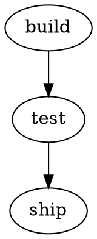

# Graphs in Markdown

````markdown

````

The built-in Markdown preview draws the block. For a bigger view, run Graphviz: Open Preview to the Side in the Markdown file. It shows the block under the cursor, and a picker lists every block.
